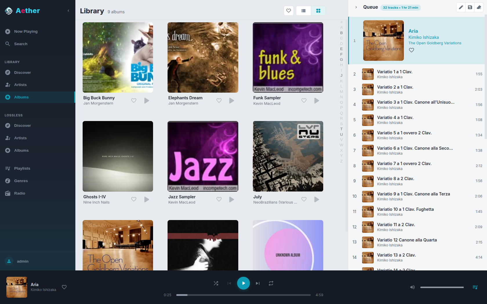

# Aether website

The landing page and user documentation for
[Aether](https://github.com/aether-music-player/aether-server), a self-hosted
music server with a web player and an OpenSubsonic API. Published at
<https://aether-music-player.github.io/>.

## What's here

- A landing page that shows what Aether does and how it looks
- Install, quickstart and configuration guides for running your own server
- Guides for libraries, scanning, sign-in and connecting apps like Symfonium
- What "pre-release" means today and what Aether does not plan to do

## Usage

Read the docs at <https://aether-music-player.github.io/docs/>. To fix or add a
page, edit the markdown under `content/docs/` (every page on the site has an
edit link) and open a pull request. A push to `main` publishes the site.

Internal and contributor docs for the server live in
[aether-server](https://github.com/aether-music-player/aether-server)'s `docs/`.

## Development

See [DEVELOPMENT.md](DEVELOPMENT.md).
